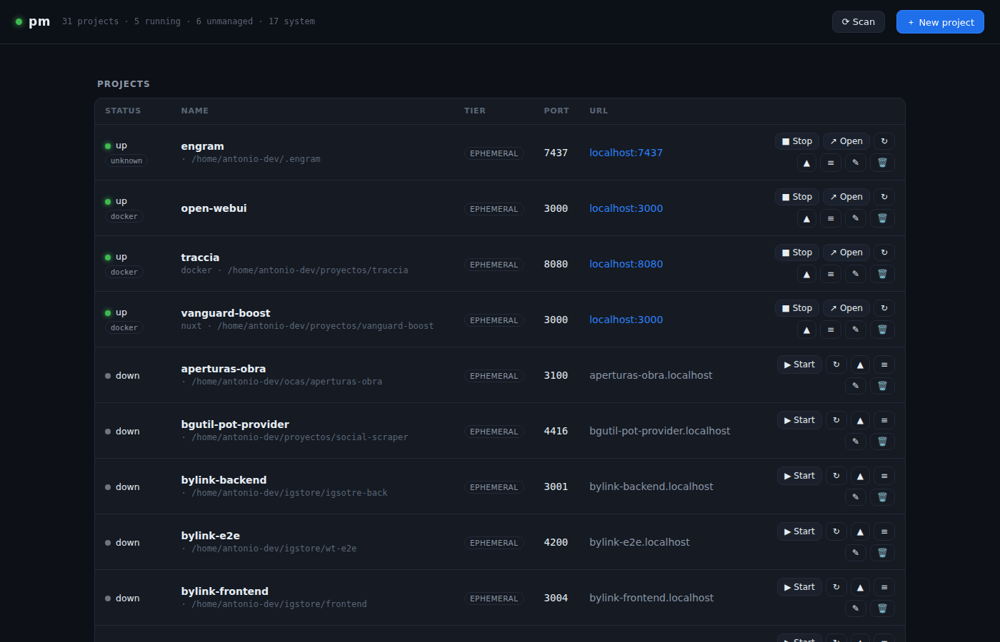

# pm — local project & port manager

[](https://github.com/antoniojosev/pm/actions/workflows/ci.yml)
[](LICENSE)
[](go.mod)
[](https://github.com/antoniojosev/pm/releases)

A single Go binary that knows **what runs on which port**, lets you **start/stop** projects from any stack, gives them a **name in the browser** (`<project>.localhost`), and exposes everything over **CLI**, **web dashboard**, **HTTP API** and an **MCP server** so coding agents can manage your dev servers too.

Built for WSL2 + systemd + Chrome.



## Core idea

- **Launch anything with a prefix**: `pm run -- npm run dev`. pm puts it inside a *systemd unit* (`pm-<project>.service`) with the `PM_PROJECT` env var (and `PM_OWNER` when it has an owner), so it can **attribute** the process and **kill its whole tree** when you stop it.
- **Detects the real system state** with `ss` + `/proc` (cwd, cgroup, cmdline) + `docker ps`. It even sees what you started outside of pm (it shows up as *unmanaged* and you adopt it).
- **Owners by marker**: a script that leaves processes running can start them with `PM_OWNER=<name>` in the environment. pm shows them with that owner (even unmanaged) and `pm down --owner <name>` stops them together with everything else the owner has.
- **Discovers the port on its own**: it looks at what the cgroup binds; no need to declare it.
- **Collision → next port**: if the preferred port is taken, it reassigns to the next free one and injects the port according to the stack (`--port` in Vite, `-p` in Next, `PORT=` env, `0.0.0.0:{port}` in Django…).
- **`.localhost` names**: Caddy on `:80` routes `myapp.localhost` → the real live port. The config regenerates itself from state.
- **Tiers**: `ephemeral` (transient service, gone when it stops) ↔ `service` (persistent user unit, starts at boot). Toggle with `promote`/`demote`. A *transient service* is what `systemd-run --user` creates without `--scope`: systemd itself starts the process as `pm-<name>.service`, so it survives the terminal, has a real unit status (`failed`, exit code, OOM reason) and can carry resource limits, and the unit vanishes by itself when the process ends. A scope, by contrast, would only wrap a process that something else already started.
- **Named compose stacks**: `--compose-project shop-qa [--compose-file compose.yml]` on `pm run --name`, `pm add` and `pm edit` (`compose: {file, project}` in the API) starts a stack as `docker compose -f <file> -p <project> ...` with `COMPOSE_PROJECT_NAME` set, so two copies of one repo (two worktrees) get their own containers, networks and volumes. Containers are attributed back by their `com.docker.compose.project` label, so each shows under its own pm name in `pm ps`. Docker projects take no limits.
- **Resource limits**: `--mem 2G --cpu 150%` caps memory and CPU through systemd (`MemoryMax=` / `CPUQuota=`). A memory cap also forbids swap (`MemorySwapMax=0`), so a project that passes it is killed by the kernel (OOM) instead of being paged out, and its unit ends `failed`: `pm ps` shows it as `✗ ... failed: oom-kill` (the dashboard and `/api/v1/ps` report status `failed` with a `failure` reason) until you start or stop it again. `pm add|edit --mem/--cpu` store the limits with the project and `pm run --mem/--cpu` remembers them (with `--name` they apply to that process only); `pm start --mem/--cpu` applies to that start only and is refused for `service`-tier projects (their unit persists: use `pm edit`, then `pm restart` so the unit on disk, which the next boot uses, is rewritten). Docker projects take no limits (the unit only wraps the compose client; set `mem_limit`/`cpus` in the compose file). Needs cgroups v2 with the `memory` and `cpu` controllers delegated to your user manager; `pm doctor` tells you if either is missing.

## Install

```bash
make install                # builds and copies the binary to ~/.local/bin/pm
pm setup                    # prepares ~/.pm, Caddyfile and systemd units
pm doctor                   # checks the environment
# install Caddy if missing:  sudo apt install -y caddy
systemctl --user enable --now pm-daemon pm-caddy
```

`./scripts/install.sh` does the same as `make install`. From **Windows**: copy `scripts/pm.cmd` into a folder on your PATH → `pm ps`, `pm ui`, etc. forward to WSL.

## CLI

```
pm run -- <cmd>        launches the cwd (auto-registers, detects port, marks it)
pm run --name <n> -- <cmd>     starts a command by name without registering it: --owner, --ports, -e K=V, --log, --mem/--cpu, --compose-project/--compose-file; shows in pm ps with its owner, pm stop forgets it; a run's ports are reserved while its process lives and released when it dies
pm ps                  list running projects (add -a to include stopped)
pm start|stop|restart <name>   start accepts --mem 512M --cpu 150%
pm promote|demote <name>       ephemeral ↔ permanent service
pm up|down <group>             bring a group up/down
pm down --owner <o>            stop everything that belongs to an owner (its projects, runs, and any process with PM_OWNER=<o>) and release its leases and routes; --keep-leases keeps both
pm add|edit|rm <name>          registry CRUD
pm claim <port>                adopt an 'unmanaged' listener
pm scan                        discover projects under the roots (PM_ROOTS)
pm listen                      ports on the machine that pm doesn't manage
pm lease [n] --owner <o>       reserve n ports for an owner before starting anything (ls, release <id>)
pm route add <host> <port>     publish <name>.localhost for a port pm did not start, optional --owner (ls, rm <host>); an explicit route wins over a project's own name
pm logs <name> [-f]            logs (stream with -f)
pm open <name> | pm ui         open in the browser
pm serve                       start the daemon (API + web + SSE + MCP)
pm doctor | pm setup
```

## What `scan` does and what the detector does

They answer two different questions and are easy to mix up.

- **`pm scan` looks at your disk.** It walks each folder in `PM_ROOTS` one level deep and, for every directory it recognizes by its files, registers a *draft* project: stack, launch command, preferred port and how to inject a port (`docker-compose.yml` → docker, `pubspec.yaml` → Flutter, `manage.py` → Django, `go.mod` → Go, `package.json` → Next/Vite/Nuxt/plain Node, with the package manager picked by lockfile). It never overwrites a project you already registered, and anything you set by hand wins over a rescan. `pm run` and `pm claim` reuse the same stack detection (`internal/scan`).
- **The detector looks at the live machine.** On every refresh it reads `ss` for each listening socket and attributes it to a project through `/proc` and `docker ps`, from the most to the least certain signal: the `PM_PROJECT` marker in the process environment, the `pm-<name>` systemd cgroup, docker labels, and finally the process cwd matching a registered project directory. What it cannot attribute is *unmanaged* (`pm listen`) until you `pm claim` it. It also reads `PM_OWNER` and the compose project label (`internal/detector`).

In short: `scan` decides what *could* run (registry), the detector reports what *is* running and whose it is (state). Neither starts anything.

## Use pm from your tool

If you build a tool that needs ports or processes on a developer machine (a worktree manager, a test harness, a task board), don't allocate ports or call `systemd-run` yourself: ask pm, which is the single owner of ports on the box. The HTTP API is versioned under `/api/v1/` and documented in [`docs/api/openapi.yaml`](docs/api/openapi.yaml), and there is an official Go client that imports only the standard library:

```bash
go get github.com/antoniojosev/pm/client
```

```go
ctx := context.Background()
c := client.New("http://127.0.0.1:9797")

v, err := c.Version(ctx) // fails if the daemon speaks another API generation
if err != nil {
    log.Fatal(err)
}
fmt.Println("pm", v.Version, "docker:", v.Docker)

// Reserve two ports for a worktree before starting anything.
lease, err := c.Leases.Create(ctx, client.LeaseRequest{Owner: "wt-qa", Count: 2})
if err != nil {
    log.Fatal(err)
}

// Start a process by specification: no registration needed.
unit, err := c.Run(ctx, client.RunSpec{
    Name:   "api-qa",
    Dir:    "/home/me/src/api",
    Cmd:    []string{"npm", "run", "dev"},
    Env:    map[string]string{"PORT": fmt.Sprint(lease.Ports[0])},
    Limits: client.Limits{Memory: "2G", CPU: "150%"},
    Owner:  "wt-qa",
    Ports:  lease.Ports,
})
if err != nil {
    log.Fatal(err)
}
fmt.Println("started", unit.Unit, "pid", unit.PID)

// Stop everything of the owner and release its leases.
if _, err := c.Owners.Delete(ctx, "wt-qa"); err != nil {
    log.Fatal(err)
}
```

The client checks `GET /api/v1/version` before its first call and returns `client.ErrIncompatible` if the daemon speaks another API generation. The same operations exist from the shell (`pm lease`, `pm run --name`, `pm down --owner`) and over MCP (`pm_run`, `pm_owner_down`). See [`client/README.md`](client/README.md) and the runnable [`client/example_test.go`](client/example_test.go).

## Web

`http://pm.localhost` (or `pm ui`). Live dashboard (SSE): status, start/stop, promote/demote, streaming logs, adopt unmanaged listeners, groups and full CRUD.

## MCP

The daemon exposes MCP over HTTP at `/mcp`. Add it to your `.mcp.json`:

```json
{ "mcpServers": { "pm": { "type": "http", "url": "http://127.0.0.1:9797/mcp" } } }
```

Tools (mirror of the CLI): `pm_list`, `pm_start`, `pm_stop`, `pm_restart`, `pm_promote`, `pm_demote`, `pm_register`, `pm_remove`, `pm_claim`, `pm_scan`, `pm_logs`, `pm_group_up`, `pm_group_down`, `pm_run` (start a process by specification, same body as `POST /api/v1/run`), `pm_owner_down` (what `pm down --owner` does).

## Config

| Variable           | Default                 | Meaning                                                              |
| ------------------ | ----------------------- | -------------------------------------------------------------------- |
| `PM_HOME`          | `~/.pm`                 | Runtime root: registry, logs, Caddyfile.                             |
| `PM_ROOTS`         | `~/projects`            | Folders `pm scan` walks (one level deep), separated by `:`.          |
| `PM_DAEMON_URL`    | `http://127.0.0.1:9797` | Where the CLI/web look for the daemon.                               |
| `PM_REMOTE_SUFFIX` | `.pm`                   | Extra DNS suffix routed by Caddy (e.g. via Tailscale). `off` disables. |
| `PM_NO_PROXY`      | unset                   | `1` stops the daemon from managing the Caddyfile (secondary daemons, tests). |

## Development

```bash
make build     # ./pm with the git version stamped in
make test      # go test -race ./...
make vet       # go vet + gofmt check
make cover     # per-package coverage
```

Tests run fully isolated: temp `PM_HOME`, injected live state, and `systemctl` / `systemd-run` / `docker` replaced by fakes, so they never touch a real daemon or `~/.pm`.

## Architecture

```
cmd/pm            entrypoint
client/           official Go client for the HTTP API (public, stdlib only)
internal/
  config          paths and constants
  registry        persistent catalog (JSON)
  detector        real state: ss + /proc + docker
  scan            stack detection / auto-registration
  runner          systemd units, ports, collision, tiers, groups
  proxy           generates Caddyfile + reload
  daemon          HTTP API + SSE + embedded web + proxy reconciliation
  api             shared service layer (CLI + daemon + MCP)
  mcp             MCP server (streamable HTTP)
  cli             cobra commands
  webui           embedded dashboard (go:embed)
```

One core, four faces: CLI, Web, HTTP API and MCP all share `internal/api`.

The web dashboard is a single dependency-free HTML file (`internal/webui/dist/index.html`) embedded in the binary with `go:embed`. There is no frontend build step: edit the file, `make build`, done.

## Alternatives

| Tool | What it does | What pm adds |
| --- | --- | --- |
| [overmind](https://github.com/DarthSim/overmind) / [foreman](https://github.com/ddollar/foreman) | Run the processes of **one** `Procfile` in a tmux session / foreground. | pm is machine-wide: every project on the box, each in its own systemd unit that survives the terminal, plus discovery of processes it did not start. |
| [portless](https://github.com/vercel-labs/portless) | Gives Node dev servers a `*.localhost` name instead of a port. | pm names any stack (Node, Django, Go, Flutter, docker-compose…), resolves port collisions by itself, and keeps Caddy in sync from live state rather than from a wrapper. |
| [devbox](https://github.com/jetify-com/devbox) | Reproducible per-project dev environments (Nix) with `devbox services`. | pm does not manage toolchains at all; it manages what is *running*: ports by name, `.localhost` routing, an MCP server for agents, and systemd services for clean process trees. They compose fine. |

In short, pm is the piece that answers "what is running, on which port, and how do I reach it by name" for a whole machine, and exposes that to humans (CLI/web) and agents (MCP) alike.

## License

[MIT](LICENSE) © Antonio Vila
